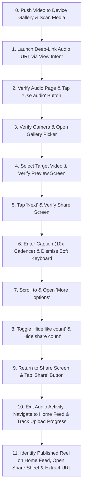

# Product Requirements Document (PRD)
## Instoper — Automated Instagram Reel Publishing Platform

> [!NOTE]
> **Canonical Location:** This document has been organized into the central documentation directory at [`docs/PRD.md`](docs/PRD.md).
> All implementation plans are organized at [`docs/plans/`](docs/plans/).
> This root copy is retained for backwards compatibility with direct file references.

---

## 1. Executive Summary & Product Overview

**Instoper** is an enterprise-grade Android automation system engineered for automated, stealthy, and reliable publishing of Instagram Reels. It pairs a **Flask-powered web control center** with a **Human Behavior Anti-Bot Engine** and **Android UIAutomator2** automation harness.

Unlike standard API-based publishers that are constrained by Meta Graph API limitations (e.g. copyright blocks, lack of trending music access, shadowbans), Instoper automates the native Instagram Android mobile client directly on real Android devices. It attaches trending Instagram audio tracks via deep links, enters custom captions/hashtags, sets privacy toggles (hide likes/shares), tracks upload progress on the live home feed, and extracts the final published Reel URL without human intervention.

---

## 2. Problem Statement & Solution

| Traditional API / Basic Script Flaws | Instoper Solution |
| :--- | :--- |
| **API Audio Limitations**: Meta Graph API forbids using commercial/trending music tracks. | **Native Client Automation**: Attaches any public Instagram audio URL directly in the Android app. |
| **Bot Detection & Shadowbans**: Linear ADB clicks, static coordinates, and instant inputs trigger Instagram anti-spam heuristic engines. | **HumanBehaviorEngine**: Simulates realistic human thumb articulation via Cubic Bézier curves, Gaussian click distribution, finger dwell times, and 10x cadence typing. |
| **Unreliable Blind Sleeps**: Flaky automations break whenever network lag, loading spinners, or unexpected popups occur. | **Screen State Verification Engine**: Every single transition is verified through UI element inspection and auto-dismisses popups before progressing. |
| **No Visibility**: Terminal-only scripts leave operators blind if an error occurs. | **Real-Time Web Mirror & Control Studio**: Live MJPEG video stream (10–12 FPS), interactive touch injection, live SSE console logs, and 11-step visual status pipeline. |

---

## 3. Core Features

### 3.1. Human Behavior & Anti-Bot Engine
- **Cubic Bézier Curve Trajectories**: Gestures generate smooth non-linear arcs with randomized perpendicular deviations and sinusoidal ease-in/ease-out acceleration profiles.
- **Gaussian Click Distribution**: Coordinates deviate organically from target button centers using standard distribution ($\sigma = 2\text{px}-4\text{px}$) rather than dead-center machine precision.
- **Micro Touch Dwell Times**: Taps execute genuine `MotionEvent` touch-down, dwell (65ms–125ms), and touch-up cycles.
- **10x Human Cadence Typing**: Streams text in word-sized chunks with micro-jitter (5ms–12ms), completing 500+ character captions in under 2 seconds while preserving natural biometric rhythm.
- **Adaptive Snappy Scrolling**: Viewport coverage calibrated at 45% per stroke with 0.12s–0.20s duration to navigate settings rapidly without triggering spam filters.

### 3.2. State Verification & Self-Healing Engine
- **Pre- & Post-Action Verification**: Every step confirms expected screen states (Audio Details, Reel Camera, Gallery Picker, Video Preview, Share Sheet, Home Feed) before performing actions.
- **Automated Popup Dismissal**: Detects and neutralizes unexpected Instagram popups (e.g., "Allow notifications", "Terms updated", "Audio unavailable", rate limit prompts) on the fly.
- **Hardware Keyboard Management**: Dispatches Android hardware `KEYCODE_BACK` (`input keyevent 4`) to cleanly dismiss the soft IME keyboard without clearing text.
- **Audio Stack Decoupling**: Automatically detects and closes underlying `ModalActivity` / `ClipsAudioUrlHandlerActivity` to transition cleanly to `InstagramMainActivity`.

### 3.3. Web Control Studio & Live Device Mirror
- **Interactive Device Mirror**: Low-latency MJPEG video stream (10–12 FPS) displaying the phone screen in a sleek smartphone frame.
- **Bidirectional Touch Injection**: Click anywhere on the browser mirror to send instant tap events directly to the physical Android device.
- **11-Step Visual Progress Tracker**: Interactive pipeline highlighting Active (pink pulse), Done (emerald check), and Pending states.
- **Live SSE Terminal**: Server-Sent Events stream colored logs (`info`, `success`, `warning`, `error`) in real time to the browser.
- **Drag-and-Drop Video Uploader**: In-browser video dropzone with preview player, size detection, and direct upload capability.
- **1-Click Published URL Extraction**: Automatically copies and presents the newly published Reel URL with a one-click copy button.

---

## 4. System Architecture

```mermaid
graph TD
    User([Web User / Operator]) -->|Browser UI:5000| WebDashboard[Instoper Web Studio]
    
    subgraph Web Server Layer [Flask Backend : app.py]
        WebDashboard -->|HTTP REST| APIEndpoints[API Endpoints: /api/start, /api/tap, /api/upload_video]
        WebDashboard -->|Server-Sent Events| SSEStream[/api/logs Live SSE Log Stream]
        WebDashboard -->|MJPEG Stream| MirrorStream[/api/stream Screen Mirror]
        CaptureThread[Background Frame Capture Thread] -->|JPEG Frames| MirrorStream
    end

    subgraph Automation Engine [Core Automation : adb.py]
        APIEndpoints -->|Spawn Thread| Uploader[InstagramReelUploader]
        Uploader --> StateVerifier[State Verification & Self-Healing]
        Uploader --> HumanEngine[HumanBehaviorEngine : human_behavior.py]
        Uploader --> DeviceBridge[ADB & UIAutomator2 Client]
    end

    subgraph Android Device [Target Device : LD7j-AS]
        DeviceBridge -->|TCP / atx-agent| UIAutomatorService[Android UIAutomator2 Service]
        DeviceBridge -->|ADB Shell| MediaScanner[Media Scanner & Intent Launcher]
        CaptureThread -->|d.screenshot| ScreenBuffer[Device Display Buffer]
        UIAutomatorService --> InstagramApp[Instagram App : com.instagram.android]
    end
```

---

## 5. End-to-End Workflow Execution (11-Step Pipeline)



### Detailed Execution Breakdown
1. **Media Ingestion**: Video file is uploaded via web dashboard or picked from phone gallery, copied to `/sdcard/DCIM/Camera/`, and scanned into Android MediaStore via `am broadcast -a android.intent.action.MEDIA_SCANNER_SCAN_FILE`.
2. **Audio Track Attachment**: Opens the specified Instagram audio URL using Android View Intent (`am start -a android.intent.action.VIEW -d <url> -p com.instagram.android`).
3. **Camera Initialization**: Verifies audio track page and taps the primary `Use audio` button with Gaussian click coordinates.
4. **Media Selection**: Taps the bottom-left gallery thumbnail to open the device gallery picker, selects the target video, and verifies arrival on the video preview editor.
5. **Advancing to Composer**: Clicks `Next` and verifies that the `New Reel` metadata sheet is displayed.
6. **Caption & Hashtags Injection**: Locates `caption_input_text_view`, inputs text via 10x chunked human cadence, and dispatches hardware keyevent `4` to drop the IME keyboard.
7. **Advanced Configuration**: Smoothly scrolls down using Bézier curves to locate and open `More options`.
8. **Privacy Switches**: Finds and toggles `Hide like count on this reel` and `Hide share count on this reel` to ON state, then returns back to the composer screen.
9. **Submission**: Verifies Share button visibility and clicks `Share` to submit the Reel.
10. **Audio Activity Exit & Feed Monitoring**: Closes the parent `ModalActivity`/`ClipsAudioUrlHandlerActivity` by pressing back until `feed_tab` is visible. Double-taps the Home icon to scroll to the top of the feed and watches `row_feed_share_progressbar` / `Sharing as reel...` status until completion.
11. **URL Extraction**: Taps the newly posted Reel or completion banner (`Posted! All set.`), opens the share drawer, taps `Copy link`, polls the Android clipboard for the `/reel/` URL, and broadcasts it to the GUI.

---

## 6. Technical Stack

| Component | Technology | Version / Specification | Role |
| :--- | :--- | :--- | :--- |
| **Backend Framework** | Python / Flask | 3.x / Flask 3.0+ | Web application server, REST APIs, SSE stream, background threading. |
| **Device Automation** | `uiautomator2` | 2.16+ | Direct RPC communication with Android `atx-agent` on device. |
| **Device Communication** | Android Debug Bridge (ADB) | 1.0.41+ | File pushing, process inspection, media scanning, intent dispatching. |
| **Anti-Bot Simulation** | Custom Pure-Python | Cubic Bézier, Gaussian Jitter | Human touch biometrics, ballistic movement, typing simulation. |
| **Frontend Styling** | Tailwind CSS (CDN) | 3.4+ | Dark-themed glassmorphism UI, responsive layout. |
| **Icons & Media** | FontAwesome 6 | Free CDN | UI icons and controls. |
| **Video Streaming** | MJPEG over HTTP | 10–12 FPS / JPEG | Real-time Android display mirror. |
| **Target Application** | Instagram Android | Native APK | Target social media client (`com.instagram.android`). |

---

## 7. Project File Structure

```
e:\Download\Code\Platfrom-tool\
├── adb.py                  # Core automation orchestrator (InstagramReelUploader)
├── human_behavior.py       # Anti-bot human biometric simulation engine
├── app.py                  # Flask web server, REST endpoints, MJPEG streaming thread
├── start_gui.bat           # 1-click Windows launcher script
├── PRD.md                  # Comprehensive Product Requirements Document (this file)
├── README.md               # Quickstart guide and operational manual
├── requirements.txt        # Python dependency manifest
├── uploads/                # Temporary storage for videos uploaded through the web UI
└── templates/
    └── index.html          # Modern dark-mode Studio dashboard with live mirror & logs
```

---

## 8. Anti-Bot & Stealth Specifications

```
  Human Touch Model:
  Start (x0, y0) ───[ Bézier Curve + Jitter ]───> Control P1 ───> Control P2 ───> End (x1, y1)
  |                                                                                      |
  +-- TouchDown                                                            TouchUp ------+
      Dwell: 65ms–125ms                                                    Post-pause: 120ms
```

1. **Path Physics**:
   - $\text{Arc Deviation} = \text{Distance} \times \text{Uniform}(0.06, 0.12)$
   - Eased time profile: $t_{\text{eased}} = \frac{1 - \cos(t \cdot \pi)}{2}$
   - Physiological micro-tremor added at every intermediate trajectory node ($\pm 1\text{px}$).
2. **Click Coordinates**:
   - Button bounds: $[x_1, y_1, x_2, y_2]$
   - Point generated: $x = \mu_x + \mathcal{N}(0, \sigma_x^2)$, clamped safely within the inner 75% boundary of the element.
3. **Typing Rhythm**:
   - Word chunks streamed via `d.set_fastinput_ime(False)` or direct unicode character bursts with 5ms–12ms variable pauses between tokens.

---

## 9. Failure Modes & Self-Healing Matrix

| Failure Mode | Detection Indicator | Self-Healing Action |
| :--- | :--- | :--- |
| **Stuck on Audio Screen after Share** | `app_current()` remains `ModalActivity` / `ClipsAudioUrlHandlerActivity`. | Iterative back navigation loop until `feed_tab` exists; double-tap `feed_tab` to align feed. |
| **Soft Keyboard Obscuring Share Button** | Soft keyboard (`ime_switcher`) open; `share_button` hidden below viewport. | Dispatches Android hardware `KEYCODE_BACK` (`input keyevent 4`); scrolls down 45% if button is scrolled out of view. |
| **Unexpected Permission / Policy Popups** | Popups matching "Allow", "Not now", "Cancel", "OK", "Dismiss". | Scans common dialog resource IDs and clicks dismissal options automatically before re-verifying. |
| **Upload Bar Timeout / Network Hiccup** | Progress bar not detected or exceeds 120s limit. | Falls back to checking profile tab and recent uploads to ensure upload completion before proceeding. |
| **Non-Reel Link in Clipboard** | Clipboard contents lack `/reel/` or `/p/` identifier. | Clears clipboard, waits 1.5s for bottom sheet animation, and polls clipboard for up to 8s. |

---

## 10. Future Roadmap

1. **Multi-Device Farm Support**: Parallel dispatch across multiple connected ADB device serials simultaneously.
2. **Carousel & Single Image Posts**: Extending pipeline beyond Reels to single images and carousel photo sets.
3. **Scheduled Queue System**: Storing queued posts in a local SQLite database for scheduled background publishing.
4. **AI Auto-Caption & Hashtags Generator**: Integrating Gemini API for automatic contextual caption and hashtag suggestions based on uploaded video content.
